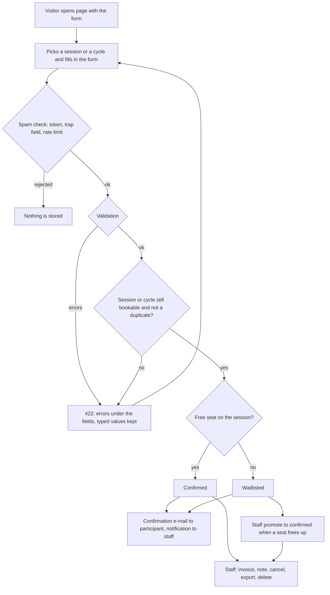

# How the product works

Gezonder in Werk Booking is a WordPress plugin for Gezonder in Werk B.V. It lets healthcare professionals enrol for training courses (nascholingen and webinars) through a form on the website, and lets staff manage those enrolments in the WordPress admin.

Terms such as Course, Session, Cycle and Enrolment are defined in the [glossary](GLOSSARY.md). For the code behind this, see [ARCHITECTURE.md](ARCHITECTURE.md).

## The big picture

```
Staff set up the catalogue  ->  Visitors enrol on the website  ->  Staff follow up in the admin
(courses, sessions, cycles)     (form, confirmation e-mail)         (confirm, invoice, export, delete)
```

## The enrolment flow



For a cycle the seat check runs for every session in it, and the whole submission is stored or not at all. Each session gets its own outcome.

Screens of every step, with the real Dutch labels and messages: [Enrolment flow screens](https://claude.ai/artifact/7zPusi3bvVPdkdVBAoDfTC). The names and dates in them are examples.

## For staff: setting up what can be booked

All screens are in the WordPress admin. They need the capability `gzw_manage_enrolments`, which administrators get automatically.

1. **Courses.** Create a Course with a title, description, accreditation text and price. A course has no date of its own.
2. **Sessions.** Under a course, add Sessions: date, start and end time, location, and an optional capacity (leave empty for unlimited). A session can be closed by hand to stop enrolments.
3. **Cycles.** Optionally bundle several sessions into a Cycle with one bundle price, so people can enrol for the whole series at once.
4. **Place the form.** Put the shortcode `[gezonder_inschrijfformulier]` on any page.

A session is offered on the form only while it is open and its date is today or later. A cycle is offered only while all its sessions are still bookable.

A session cannot be deleted while it has active enrolments or belongs to a cycle. Deleting a course deletes its sessions.

## For visitors: enrolling

1. The visitor opens the page with the form and picks a session, or a whole cycle.
2. They fill in their details: first and last name, e-mail address, employer, BIG registration number, the invoice details (invoice name, address, postcode, city, invoice e-mail, plus optional PO/reference number, KvK and VAT number), and tick both consent boxes (cancellation terms and privacy statement).
3. The form is checked on the server. Mistakes, such as an invalid BIG number or a missing consent, are shown next to the field and everything the visitor typed is kept.
4. On success the visitor sees one of these outcomes and receives a matching e-mail:
   - **Confirmed**: the session has a free seat.
   - **Waitlisted**: the session is full. The enrolment is stored but not confirmed, and the visitor is told they will be contacted if a seat frees up.
   - **Cycle**: one enrolment is made per session in the cycle. Each session gets its own outcome, so a person can be confirmed for some and waitlisted for others. The submission is all or nothing: if it cannot be stored, nothing is stored.

Things that stop an enrolment:

- The session or cycle has closed in the meantime.
- The same e-mail address already has an active enrolment for that session.
- The submission looks like spam (see below).

Staff receive an e-mail for every new enrolment, with a link to it in the admin. The address is set in Settings under "Meldingen naar".

## For staff: following up

The **Enrolments** screen lists all enrolments with filters and search. Open one to see its full details.

- **Status.** An enrolment is confirmed, waitlisted or cancelled. Cancelling frees the seat and lets the same e-mail address enrol again.
- **Promote from the waitlist.** When a seat frees up, staff promote a waitlisted enrolment to confirmed by hand. Nothing is promoted automatically.
- **Invoiced and note.** Mark an enrolment as invoiced and keep an internal note. The note is never shown to the participant.
- **Export.** Export the filtered list to CSV for invoicing or reporting.
- **Delete.** Remove an enrolment. For a cycle submission the whole group is removed together.

## Capacity and fairness

When several people submit at the same time, the plugin handles seats one session at a time. Capacity is never exceeded, and a session that has just closed never receives a confirmed enrolment.

## Privacy and spam protection

- Enrolments hold personal data, so both consent boxes are required and the consent is stored with the enrolment.
- The form has a hidden security token, a hidden trap field for bots, and a limit of 10 attempts per IP address per 10 minutes. Rejected submissions are not stored.
- **Retention.** A daily job anonymises enrolments whose session date is older than the retention period (24 months by default, 0 keeps everything). Personal data is wiped. Price, status and the consent record stay. A cycle group is anonymised once its last session is old enough.
- **Uninstall.** Deleting the plugin keeps the enrolment table unless "Verwijderen van de plugin" is switched on in Settings first.

## Settings

| Setting | What it does |
| --- | --- |
| Meldingen naar | E-mail address that receives new-enrolment notifications. |
| Bewaartermijn (maanden) | How long personal data is kept after the session date. |
| SnelStart: dagboek verkoop, grootboek debiteuren / omzet / BTW hoog | Ledger numbers from your SnelStart. When all four are filled in, the staff notification e-mail carries a SnelStart booking CSV (3 lines: debtors, revenue, 21% VAT). Customer code and invoice number are left empty for staff to fill in before importing. Empty means no attachment. |
| Verwijderen van de plugin | Whether uninstalling also deletes all data. |

## Language

The interface, form and e-mails are in Dutch.
